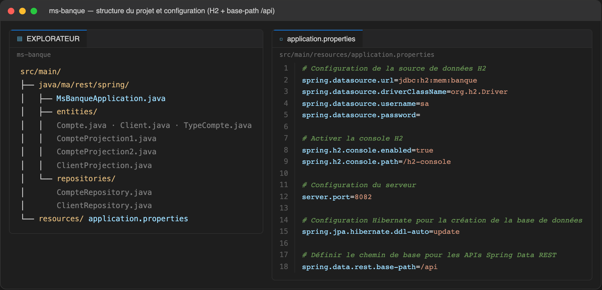
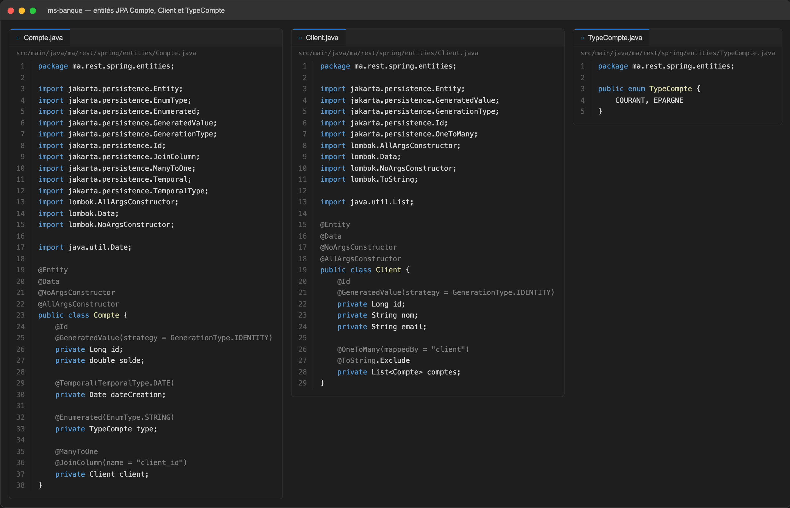
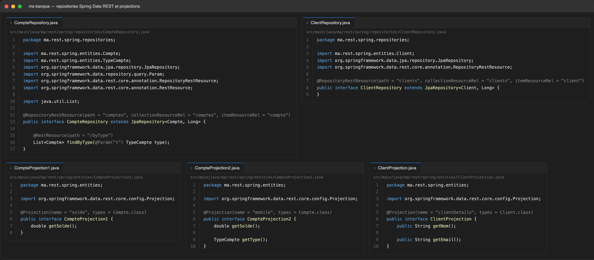
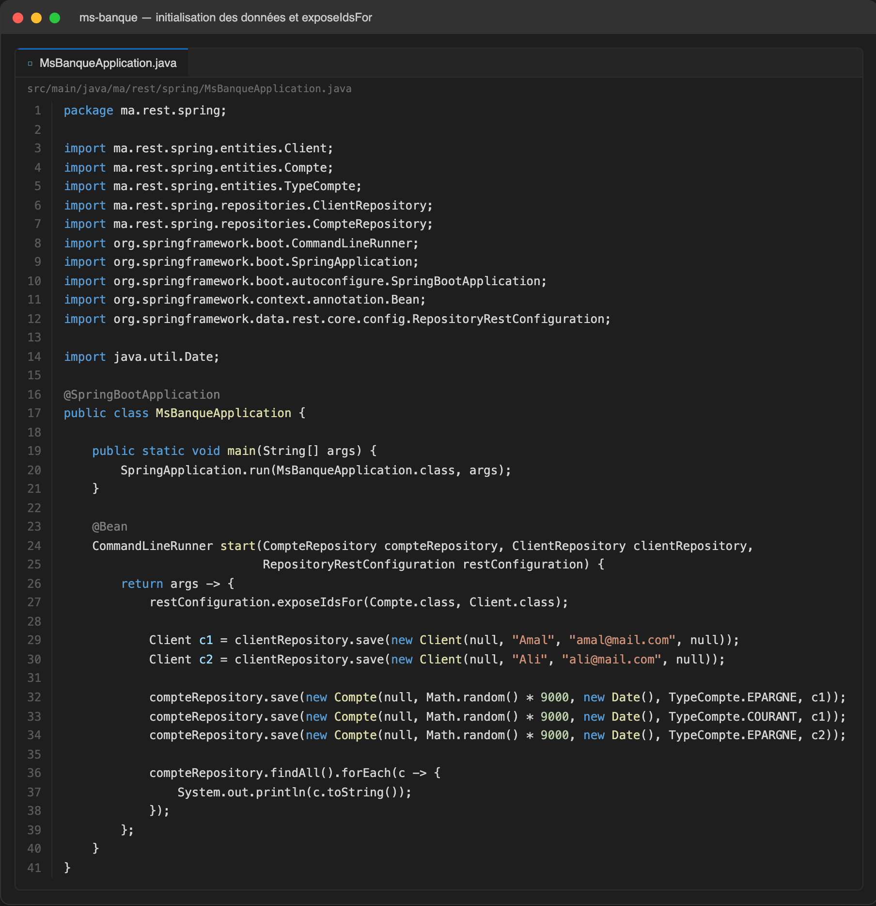
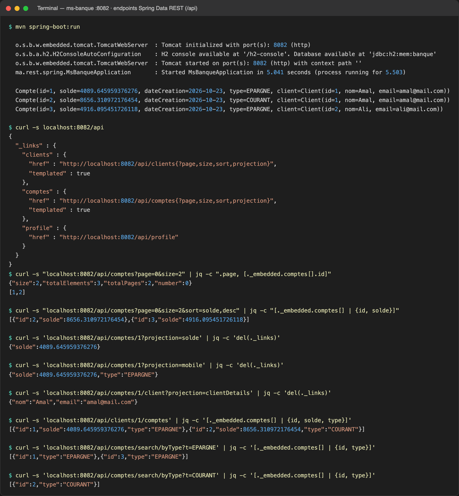

# TP 11 : Spring Data REST

Application Spring Boot `ms-banque` exposant automatiquement les repositories JPA `Compte` et `Client` comme ressources REST HATEOAS sous le chemin de base `/api` (base de données H2 en mémoire), avec projections, pagination, tri, recherche par type et navigation des relations.

## 1. Structure du projet et configuration

## 2. Entités JPA : Compte, Client et TypeCompte

## 3. Repositories Spring Data REST et projections

## 4. Initialisation des données et exposition des identifiants

## 5. Exécution : HAL, projections, pagination et recherche

